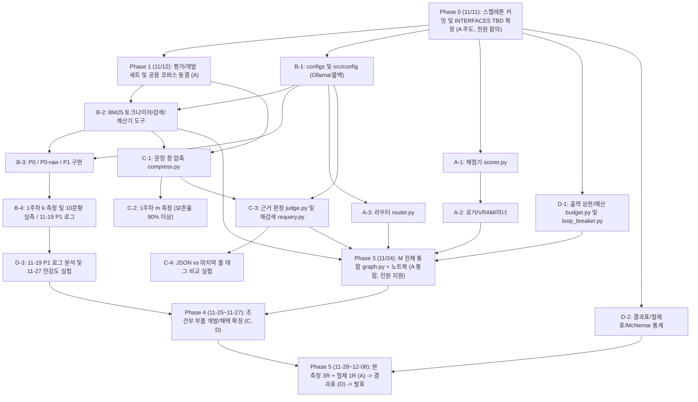

# M(EBA) 역할별 구현 작업 분해 계획 (Implementation Plan)

> **기준 문서:** [SPEC.md](SPEC.md) · [INTERFACES.md](INTERFACES.md) · [SCHEDULE.md](SCHEDULE.md) · [EVALUATION.md](EVALUATION.md) · [src/README.md](../src/README.md) · [AGENTS.md](../AGENTS.md)  
> **작성일:** 2026-11-11

이 문서는 4명의 팀원(**고용민·이현성·조환호·심동섭**)이 `11/11`부터 `12/08` 발표까지 병행 개발하고 `11/24`에 충돌 없이 통합하기 위한 **파일·모듈·PR 단위 작업 분해(WBS)**, **선후 의존성**, **미결 규격(`TBD`)**, **검증 방법**을 정리한 실행 계획입니다.

---

## 1. 전체 의존성 및 마일스톤 흐름



---

## 2. 착수 전 선결 사항 및 `TBD` 확정 목록

> [!IMPORTANT]
> **저장소 및 협업 규칙 선행 정리**
> 1. **미추적 스켈레톤 커밋 선행 (A 담당):** `.github/`, `data/frozen/.gitkeep`, `scripts/.gitkeep`, `src/*/.gitkeep`, `tests/.gitkeep` 등 초기 폴더 스켈레톤과 `main` 보호 규칙을 먼저 커밋·설정해야 팀원이 `clone`/`pull` 시 동일한 구조를 받습니다.
> 2. **브랜치 네이밍 규칙 통일:** [CONTRIBUTING.md](../CONTRIBUTING.md) (`<역할>/<주제>`, 예: `a/scorer`)와 개인 작업 브랜치(`YongMin`, `HwanHo`, `HyunSeong` 등) 중 팀이 PR에 사용할 규칙을 하나로 통일합니다.
> 3. **`11/12` 동결 하드 게이트 (A 담당):** `data/frozen/` 세 파일(`eval.jsonl`, `dev.jsonl`, `corpus.jsonl`)과 `MANIFEST.json`은 **11/12 동결 이후 절대 수정 금지**입니다([AGENTS.md](../AGENTS.md)).

### 코드 착수 전(`11/11~11/12`) 확정할 `TBD` 7가지

1. **SQuAD 2.0 문맥 단위 분리 여부 & `data.seed` / `doc_id` 규칙 (A 제안 → 전원 확인):** 개발/평가 세트 간 문단 공유 방지 여부([EVALUATION.md §1](EVALUATION.md)), `doc_id` 포맷(`hp::<title>`, `sq::<article>::<paragraph_idx>`), 시드 확정.
2. **설정 파일 포맷 및 Ollama 태그 (B 결정):** `configs/` 포맷(`yaml` vs `toml`), `ollama list` 기준 정확한 `model.tag`, `model.keep_alive` 값 확정.
3. **BM25 공용 토크나이저·불용어 규칙 (B·C 합의):** 검색(`bm25_search`)과 문장 창 압축(`compress`)이 동일한 토크나이저를 써야 하므로 공용 함수 시그니처 합의.
4. **P0에 `UNANSWERABLE` 기권 문구 포함 여부 (A·B·C 합의):** [INTERFACES.md §6](INTERFACES.md) 미결 사항. 결정 후 [EVALUATION.md](EVALUATION.md)에 기록.
5. **최종 답 추출 접두어 및 GSM8K 숫자 추출 규칙 (A·B·C 합의):** `Final answer:` 접두어 사용 여부, 단위·쉼표·분수·음수 파싱 규칙([EVALUATION.md §3](EVALUATION.md)).
6. **라운드 간 대표값 규칙 (D 결정):** `temperature=0`에서도 라운드 간 결과 차이가 날 경우 대표값 규칙(중앙값 / 평균 / 다수결)([EVALUATION.md §5](EVALUATION.md)).
7. **패키지 의존성 파일:** `pyproject.toml` 또는 `requirements.txt` 작성 담당 및 Python 버전(3.10+) 고정.

---

## 3. 공통 모듈 계약 (Phase 0: `11/11`, 전원 합의)

모듈 간 데이터 전달 오류를 막기 위해 [INTERFACES.md §4](INTERFACES.md)의 `CallRecord` · `PipelineResult`를 공용 타입 모듈(예: `src/common/types.py` 또는 `src/eval/schema.py`)로 먼저 고정합니다.

```python
from dataclasses import dataclass, field
from typing import Literal, Optional

@dataclass
class CallRecord:
    step: str                   # "p0" | "p1_step" | "router" | "finalize" | "judge" | "ledger"
    cap: Optional[int]
    input_tokens: int
    output_tokens: int
    truncated: bool
    is_retry: bool
    parse_ok: Optional[bool]
    latency_s: float

@dataclass
class PipelineResult:
    answer: str                 # 최종 답 문자열 (기권 시 "UNANSWERABLE")
    abstained: bool
    budget_exhausted: bool
    route: Optional[Literal["math", "search"]]
    decisions: list[str]        # 예: ["RETRIEVE", "ANSWER"]
    n_calls: int                # 예산 포함 호출 수 (재시도 제외)
    n_retries: int              # 잘림 재시도 수 (비용 지표 포함)
    calls: list[CallRecord] = field(default_factory=list)
    retrieved_doc_ids: list[list[str]] = field(default_factory=list)
    kept_windows: list[list[str]] = field(default_factory=list)
    loop_breaks: int = 0
    error: Optional[str] = None
```

확정된 `TBD` 값들은 코드 구현 전 [INTERFACES.md](INTERFACES.md) 수정 PR로 먼저 반영합니다.

---

## 4. 역할별 작업 분해 (PR · 파일 단위)

### A · 고용민 (측정·채점·재현성 + M 통합)

**담당 범위:** 데이터/코퍼스 동결, 채점기, 로거·VRAM·러너, 라우터, LangGraph 통합, Colab 원클릭/검증 노트북

| PR 단위 | 기한 | 생성/수정 파일 | 핵심 구현 내용 | 선행 조건 |
|---|---|---|---|---|
| **PR A-0** | `11/11` | 초기 스켈레톤, `pyproject.toml`, `docs/INTERFACES.md` | 미추적 `.github/`, `.gitkeep` 커밋, `main` 보호 설정, 팀원 초대 및 `TBD` 합의 반영 | 없음 |
| **PR A-1** | `11/12` | `scripts/freeze_data.py`, `data/frozen/*`, `data/README.md` | HF `hotpot_qa`/`squad_v2`/`gsm8k` 다운로드→고정 시드 샘플링(평가 120, 개발 60, 비중복)→코퍼스 중복 제거→SHA-256 기록 및 교차 검증 | `TBD` #1 |
| **PR A-2** | `11/15` | `src/eval/scorer.py`, `tests/test_scorer.py` | SQuAD 공식 정규화 EM/F1, `UNANSWERABLE` 일치 채점, GSM8K 수치 추출·비교, 공통 답 추출 함수 | `TBD` #5 |
| **PR A-3** | `11/17` | `src/eval/vram.py`, `src/eval/logger.py`, `src/eval/runner.py`, `scripts/run_eval.py`, `tests/test_eval_io.py` | 시작 전 SHA-256 검증, `nvidia-smi` 0.5초 폴링 최대 VRAM 측정, 문항별 즉시 `.jsonl` 기록 및 재개(resume), `RUN_META.json` 생성, 라운드 순서 교체, 첫 1문항 워밍업 마킹, 120초 타임아웃 | PR A-1, A-2, B-1 |
| **PR A-4** | `11/20` | `src/meba/router.py`, `tests/test_router.py` | 첫 호출 프롬프트(영어), 출력 상한 `cap.first`(512) 적용, `math`/`search` 분기, 계산기 사용 시 마무리 호출 `cap.finalize`(128) 연결 | PR B-1, B-2, D-1 |
| **PR A-5** | `11/24` | `src/meba/graph.py`, `tests/test_graph.py` | LangGraph 상태 그래프 조립(`router`→`math`/`search`→`compress`→`judge`↔`requery`), `budget`/`loop_breaker` 결합, 핵심 6개+조건부 3개 부품 on/off 절제 스위치 구현 (`qid`, `question`만 입력) | PR A-4, B-2, C-3, D-1 |
| **PR A-6** | `11/26` | `notebooks/run_all.ipynb`, `notebooks/verify.ipynb` | Colab 원클릭 실행(clone→의존성/Ollama 설치→모델 pull→해시 검증→실행) 및 소수 문항 검증 모드 | PR A-3, A-5 |

---

### B · 이현성 (기반·도구·기준선)

**담당 범위:** `configs/` 단일 설정 관리, `ChatOllama` 생성 및 콜백, BM25 검색·계산기 도구, P0/P0-raw/P1 구현, 1주차 `k`·속도 측정

| PR 단위 | 기한 | 생성/수정 파일 | 핵심 구현 내용 | 선행 조건 |
|---|---|---|---|---|
| **PR B-1** | `11/13` | `configs/default.yaml`, `src/config/settings.py`, `src/config/llm.py`, `src/config/callbacks.py`, `tests/test_config.py` | 설정 로더(모델 태그·`temperature=0`·`num_ctx=8192`·예산·상한 단일 관리), `create_chat_ollama(settings, num_predict, format_schema=None)` 팩토리, 호출 수·입출력 토큰·latency 측정 콜백 | `TBD` #2 |
| **PR B-2** | `11/15` | `src/tools/tokenizer.py`, `src/tools/bm25_search.py`, `src/tools/calculator.py`, `tests/test_tools.py` | C와 공유할 BM25 토크나이저, `corpus.jsonl` 인덱스 구축 및 `bm25_search(query, k)`(`[{doc_id, title, sentences, text, score}]`), AST 기반 안전 계산기(`"ERROR: <사유>"` 반환, 예외 미전파) | PR A-1(`corpus.jsonl`), PR B-1 |
| **PR B-3** | `11/17` | `src/baselines/prompts.py`, `src/baselines/p0.py`, `src/baselines/p1_react.py`, `tests/test_baselines.py` | 공통 답 형식 지시문(영어), `P0`(최소 지시문)·`P0-raw`(질문만), `P1`(`create_agent` + 도구 2개 + 최대 7스텝 + 공통 지시문) → 모두 `(qid, question) -> PipelineResult` 준수 | PR B-1, B-2, `TBD` #4 |
| **실험 B-4** | `11/18` | `docs/experiments/2026-11-XX-b-retrieval-k.md`, `configs/default.yaml`, `results/runs/dev/p1.jsonl` | 개발 세트(`dev.jsonl`) 검색 재현율로 **`retrieval.k`** 확정, 10문항 실측으로 문항당 소요 시간 추정 확정, **11/19 전 P1 개발 세트 로그 제출** | PR A-1, PR B-3 |

- **`AGENTS.md` 절대 규칙:** 모든 모델 호출은 LangChain `ChatOllama`를 거치며, 모델 태그·`temperature`·`num_ctx`는 `configs/`에서만 읽습니다. P1과 M은 동일한 `bm25_search`·`calculator` 구현과 오류 문자열 규칙을 씁니다.

---

### C · 조환호 (근거 쪽 부품, 전략 ③)

**담당 범위:** 검색 결과 문장 창 압축, 근거 판정 + 답 호출(프롬프트 최종 책임 + JSON/태그 대조군), 다중 홉 재검색, 1주차 `m` 측정, 조건부 부품 2개(`ledger`, `dynamic_m`)

| PR 단위 | 기한 | 생성/수정 파일 | 핵심 구현 내용 | 선행 조건 |
|---|---|---|---|---|
| **PR C-1** | `11/15` | `src/meba/compress.py`, `tests/test_compress.py` | 문단 제목을 붙인 앞뒤 1문장 창(`compress.window=1`) 생성, B의 공용 토크나이저를 사용한 문장 창 BM25 점수화 → 상위 `m`개 선택. 재검색 시 `question + " " + followup_query` 기준 점수화. `doc_id#문장번호` 리스트(`kept_windows`) 반환 (모델 호출 0회) | PR A-1, PR B-2(`tokenizer.py`) |
| **실험 C-2** | `11/17` | `docs/experiments/2026-11-XX-c-compress-m.md`, `configs/default.yaml` | `dev.jsonl`의 `supporting_facts` 기준으로 **근거 문장 보존율 ≥ 90%**를 만족하는 최소 **`compress.m`** 측정 (1차 검색·재검색 각각 측정, **GPU 불필요**) | PR A-1, PR C-1, B-4(`k` 확정) |
| **PR C-3** | `11/21` | `src/meba/judge.py`, `src/meba/requery.py`, `tests/test_judge.py`, `tests/test_requery.py` | **1)** `judge.py`: 자유 서술(`reasoning`, 1~2문장)을 맨 앞에 둔 JSON 스키마(`decision`, `missing`, `answer`) + Ollama 구조화 출력, 마지막 판정 시 `RETRIEVE` 제외 스키마, **대조군 파서**(마지막 줄 태그 + 정규식) 구현.<br>**2)** `requery.py`: `RETRIEVE` 판정 시 `missing` 기반 후속 검색어 정제·중복 회피 및 최대 2회(`budget.max_requery=2`) 제어 | PR B-1, PR D-1(상한 래퍼) |
| **실험 C-4** | `11/23` | `docs/experiments/2026-11-XX-c-judge-format.md` | 개발 세트에서 JSON 구조화 출력 vs 마지막 줄 태그 대조군의 잘림률·파싱 실패율·정확도 비교 → M 기본 포맷 확정 | PR C-3 |
| **PR C-5 (조건부)** | `11/26` | `src/meba/conditional/ledger.py`, `src/meba/conditional/dynamic_m.py`, `docs/experiments/2026-11-XX-c-conditional.md` | **1)** `ledger.py`: 질문을 정보 항목으로 분해해 `FOUND`/`MISSING` 기록 후 `MISSING`만 재검색(목표: HotpotQA 정답 수↑ 또는 호출 수 10%↓).<br>**2)** `dynamic_m.py`: 질문 특성에 따라 `m` 동적 조절(목표: 입력 토큰 10%↓) | Phase 3(`graph.py` 통합) |

- **주의:** `judge.py` JSON 스키마 키 순서는 반드시 `reasoning` → `decision` → `missing` → `answer`를 유지합니다([ADR-0004](adr/0004-m-architecture-call-budget.md)). 근거 판정 프롬프트 변경 PR의 최종 승인은 C가 담당합니다([CONTRIBUTING.md](../CONTRIBUTING.md)).

---

### D · 심동섭 (예산 쪽 부품, 전략 ① + 표·통계)

**담당 범위:** 출력 상한·잘림 감지·재시도·호출 예산 집계, 루프 끊기, 11/19 P1 로그 분석, 출력 상한 민감도 실험, 조건부 부품 1개(`concise`), 결과표·절제표·McNemar 검정

| PR 단위 | 기한 | 생성/수정 파일 | 핵심 구현 내용 | 선행 조건 |
|---|---|---|---|---|
| **PR D-1** | `11/16` | `src/meba/budget.py`, `src/meba/loop_breaker.py`, `tests/test_budget.py`, `tests/test_loop_breaker.py` | **1)** `budget.py`: 단계별 `num_predict` 상한(`512/128/256`) 적용 호출 래퍼, 잘림 감지, `cap * 2`로 **1회 재시도**(예산 제외·`CallRecord.is_retry=True`), 호출 예산 `4회` 집계 및 소진(`budget_exhausted=True`) 처리.<br>**2)** `loop_breaker.py`: `(tool_name, normalized_args)` 중복 호출 감지 시 차단 후 직전 결과로 즉시 답 유도 + `loop_breaks` 증가 | PR B-1(mock 기반 병행 가능) |
| **PR D-2** | `11/18` | `src/eval/tables.py`, `src/eval/stats.py`, `scripts/build_tables.py`, `tests/test_tables_stats.py` | `.jsonl` 로그 집계 → 본 비교표(3R), 절제표(M 대비 호출·시간 비율), 부작용 지표표(`results/tables/*.csv`, `.md`), McNemar 정확 검정(유형별 40문항 + 전체 120문항 교차표 & p-value) | [INTERFACES.md §7](INTERFACES.md), `TBD` #6 |
| **분석 D-3** | `11/19` | `docs/experiments/2026-11-19-d-p1-log-audit.md` | B가 제출한 P1 개발 세트 로그 분석(출력 토큰 비중, 형식 오류율, 반복 루프 비율) → 조건부 부품 시험 순서 및 상한 초기값 점검 보고 | 실험 B-4(P1 dev 로그) |
| **실험 D-4** | `11/26` | `docs/experiments/2026-11-XX-d-cap-sensitivity.md` | 근거 판정 단계(`cap.judge`) 출력 상한 **96 / 160 / 256** 민감도 실험 → 잘림 없이 정확도가 유지되는 최적 범위 기록 | Phase 3(`graph.py` 통합) |
| **PR D-5 (조건부)** | `11/26` | `src/meba/conditional/concise.py`, `docs/experiments/2026-11-XX-d-concise.md` | 추론 단계를 간결하게 줄이는 프롬프트/규칙(단, 수학 풀이 추론 단계는 유지) — 목표: 평균 출력 토큰 10%↓ & 유형별 순정답 수 ≥ 0 | Phase 3(`graph.py` 통합) |

---

## 5. 본 측정 및 보고 일정 (11/28 ~ 12/08, 전원)

| 단계 | 기한 | 담당 | 작업 내용 |
|---|---|---|---|
| **본 비교 측정 (3라운드)** | `11/28 ~ 12/01` | A(주도)·B | Colab 별도 세션 3회로 P0 · P0-raw · P1 · M 실행(라운드별 순서 교체), `results/runs/main/r{1,2,3}/` 커밋 |
| **절제 측정 (1라운드+)** | `12/01 ~ 12/03` | A(주도)·C·D | M + 핵심 6개 + 채택된 조건부 절제 변형 실행, `results/runs/ablation/r1/` 커밋(여유 시 기여 큰 부품 라운드 추가) |
| **결과표·통계 확정** | `12/04 ~ 12/05` | D | `scripts/build_tables.py` 실행 → `results/tables/` 커밋, McNemar 검정 결과 정리 및 버퍼 재확인 |
| **보고서·발표 자료** | `12/06 ~ 12/08` | 전원 | `docs/reports/`에 최종 보고서·발표 개요 정리(`P1 대비 정확도 +Δ, 호출 수 ×k, 추론 시간 ×t, 최대 VRAM n GB`), 12/08 발표 |

---

## 6. 검증 계획 (Verification Plan)

### 자동 테스트 (CPU 환경, Mock `ChatOllama` 활용)

```bash
# 전체 단위 테스트 실행
pytest tests/ -v

# 역할별 핵심 테스트
pytest tests/test_scorer.py tests/test_eval_io.py -v        # A: 채점·로깅·해시 검증
pytest tests/test_config.py tests/test_tools.py -v          # B: 설정·BM25·계산기
pytest tests/test_compress.py tests/test_judge.py -v        # C: 문장 창 압축·파서·재검색
pytest tests/test_budget.py tests/test_loop_breaker.py tests/test_tables_stats.py -v  # D: 예산·잘림·루프·McNemar
pytest tests/test_graph.py -v                               # A: LangGraph Mock 통합 및 절제 변형
```

- **동결 데이터 무결성 확인 (PR마다 필수):**
  ```bash
  git diff --stat origin/main -- data/frozen
  ```

### 수동/환경 검증

1. **로컬 Ollama 검증 모드 (`11/24` 통합 직후):** 소수 문항(`verify` 모드)으로 실행해 `results/runs/_scratch/`에 `.jsonl`과 `RUN_META.json`이 규격대로 남는지 확인.
2. **Colab T4 무료 환경 재현 확인 (`notebooks/verify.ipynb`):** 원클릭 설치 → 해시 검증 통과 → P0 · P1 · M 소수 문항 실행 및 중단 후 재개(resume) 확인.
3. **공정성 체크 ([EVALUATION.md §7](EVALUATION.md)):** 모든 파이프라인이 동일한 모델 태그, `temperature=0`, `num_ctx=8192`, 공통 도구 및 답 형식 지시문을 쓰는지 `RUN_META.json` 스냅샷으로 확인.
