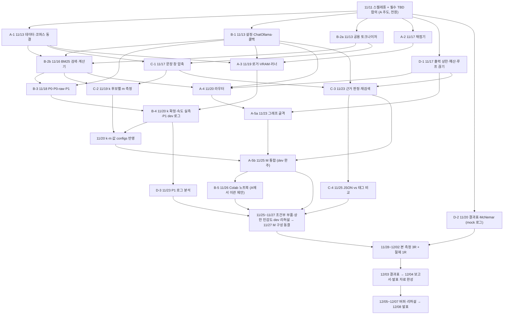

# M(EBA) 역할별 구현 작업 분해 계획 (Implementation Plan)

> **기준 문서:** [SPEC.md](SPEC.md) · [INTERFACES.md](INTERFACES.md) · [SCHEDULE.md](SCHEDULE.md) · [EVALUATION.md](EVALUATION.md) · [src/README.md](../src/README.md) · [AGENTS.md](../AGENTS.md)  
> **작성일:** 2026-11-11 · **개정:** 2026-11-11 (일정 여유 반영, §1 참고)

이 문서는 4명의 팀원(**고용민·이현성·조환호·심동섭**)이 `11/11`부터 `12/08` 발표까지 병행 개발하기 위한 실행 계획입니다. 파일·모듈·PR 단위 작업 분해(WBS), 선후 의존성, 미결 규격(`TBD`), 검증 방법을 정리합니다.

**목표:** `12/04(금)`까지 발표에 필요한 모든 것(측정 결과, 결과표, 보고서, 발표 자료)을 완성하고, `12/05~12/07`은 지연 흡수와 발표 리허설용 버퍼로 비워 둡니다.

---

## 1. 일정 원칙

설계안의 중간 마일스톤(11/12 동결, 11/19 P1 점검, 11/24 통합, 11/27 조건부 채택)은 고정 조건이 아닙니다. **12/08 발표 전에 모든 준비가 끝나는 것**만 고정 조건입니다. 그래서 일정을 다음 원칙으로 잡았습니다.

1. **버퍼는 끝에 모은다.** 중간 어디에서 밀려도 흡수할 수 있도록 12/05~12/07(3일)을 비워 둡니다. 앞쪽에 여유를 나눠 주면 그 여유는 앞에서 다 써 버리고 끝에는 남지 않습니다.
2. **넘겨받는 작업 사이에 하루 이상 둔다.** 선행 PR과 후행 PR의 마감이 같은 날이 되지 않게 합니다.
3. **마감은 평일에 둔다.** 주말(11/14~15, 11/21~22, 11/28~29, 12/05~06)에는 마감을 두지 않습니다. 단, 본 측정은 Colab에서 자동으로 돌기 때문에 주말에도 진행합니다.
4. **기다리지 않게 작업을 쪼갠다.**
   - 공용 토크나이저는 B-2에서 떼어 먼저 냅니다(B-2a).
   - C-2는 `k` 후보별로 `m`을 측정해 두고, `k` 확정을 기다리지 않습니다.
   - A는 그래프 골격(A-5a)을 먼저 만들어 C·D가 붙일 자리를 미리 마련합니다.
5. **조건부 부품은 버릴 수 있게 한다.** 11/27까지 목표 지표를 넘지 못하면 기각하고, 기각 근거도 결과로 남깁니다. 조건부 부품 때문에 본 측정을 미루지 않습니다.
6. **측정 대기 시간에 보고서를 쓴다.** 본 측정과 절제 측정은 대부분 Colab을 기다리는 시간입니다. 11/28부터 보고서의 방법·설계 부분과 발표 자료 골격을 함께 진행합니다.

### 주차별 요약

| 구간 | 기간 | 목표 | 끝났다는 기준 |
|---|---|---|---|
| 1주차 | 11/11(수) ~ 11/17(화) | 합의·동결·설정·도구·채점기·예산 래퍼 | 동결 해시 커밋, mock 단위 테스트 통과 |
| 2주차 | 11/18(수) ~ 11/24(화) | 기준선·설계 값(`k`·`m`)·M 부품 | P1 dev 로그, `k`·`m` 확정, 근거 판정·재검색 머지, 그래프 골격 |
| 3주차 | 11/25(수) ~ 11/27(금) | 통합·조건부 부품·dev 리허설 | M이 dev 세트를 완주함, 조건부 채택 확정, 라운드 시간 실측, **M 구성 동결** |
| 측정 | 11/28(토) ~ 12/03(목) | 본 측정 3R + 절제 1R + 결과표 | `results/runs/`와 `results/tables/` 커밋 |
| 마무리 | 12/04(금) | 보고서·발표 자료 완성 | 발표 가능한 상태 |
| 버퍼 | 12/05(토) ~ 12/07(월) | 지연 흡수, 발표 리허설 | |
| 발표 | 12/08(화) | | |

---

## 2. 전체 의존성 흐름



---

## 3. 착수 전 선결 사항 및 `TBD` 확정 목록

> [!IMPORTANT]
> **저장소 및 협업 규칙 선행 정리**
> 1. **미추적 스켈레톤 커밋 선행 (A 담당):** `.github/`, `data/frozen/.gitkeep`, `scripts/.gitkeep`, `src/*/.gitkeep`, `tests/.gitkeep` 등 초기 폴더 스켈레톤과 `main` 보호 규칙을 먼저 커밋·설정해야 팀원이 `clone`/`pull` 시 같은 구조를 받습니다.
> 2. **브랜치 네이밍 규칙 통일:** [CONTRIBUTING.md](../CONTRIBUTING.md)의 `<역할>/<주제>` 규칙(예: `a/scorer`)과 개인 작업 브랜치(`YongMin`, `HwanHo`, `HyunSeong` 등) 중 PR에 쓸 규칙을 하나로 정합니다.
> 3. **동결 하드 게이트 (A 담당):** `data/frozen/`의 세 파일(`eval.jsonl`, `dev.jsonl`, `corpus.jsonl`)과 `MANIFEST.json`은 **11/13 동결 이후 절대 수정 금지**입니다([AGENTS.md](../AGENTS.md)).

### `TBD` 7가지와 기한

모든 항목을 첫날 정할 필요는 없습니다. 각 항목을 **그 결정이 필요한 첫 작업**에 맞춰 정합니다.

| # | 항목 | 담당 | 기한 | 이게 정해져야 시작할 수 있는 작업 |
|---|---|---|---|---|
| 1 | SQuAD 2.0 문맥 단위 분리 여부(개발/평가 세트 간 문단 공유 방지, [EVALUATION.md §1](EVALUATION.md)), `doc_id` 포맷(`hp::<title>`, `sq::<article>::<paragraph_idx>`), `data.seed` | A 제안 → 전원 확인 | **11/11** | A-1 동결 |
| 2 | `configs/` 포맷(`yaml` vs `toml`), `ollama list` 기준 정확한 `model.tag`, `model.keep_alive` | B | **11/11** | B-1 |
| 3 | BM25 공용 토크나이저·불용어 규칙과 함수 시그니처 (검색과 압축이 같은 토크나이저를 씀) | B·C | **11/11** | B-2a, C-1 |
| 7 | 의존성 파일(`pyproject.toml` 또는 `requirements.txt`)과 Python 버전(3.10+) 고정 | A | **11/11** | 전원 착수 |
| 4 | P0에 `UNANSWERABLE` 기권 문구를 넣을지 ([INTERFACES.md §6](INTERFACES.md)). 결정 후 [EVALUATION.md](EVALUATION.md)에 기록 | A·B·C | 11/13 | B-3 |
| 5 | 최종 답 추출 접두어(`Final answer:`) 사용 여부, GSM8K 숫자 추출 규칙(단위·쉼표·분수·음수, [EVALUATION.md §3](EVALUATION.md)) | A·B·C | 11/13 | A-2 |
| 6 | `temperature=0`에서도 라운드 간 결과가 다를 때 대표값 규칙(중앙값 / 평균 / 다수결, [EVALUATION.md §5](EVALUATION.md)) | D | 11/16 | D-2 |

---

## 4. 공통 모듈 계약 (`11/11`, 전원 합의)

모듈 간 데이터 전달 오류를 막기 위해 [INTERFACES.md §4](INTERFACES.md)의 `CallRecord` · `PipelineResult`를 공용 타입 모듈(예: `src/common/types.py` 또는 `src/eval/schema.py`)로 먼저 고정합니다.

```python
from dataclasses import dataclass, field
from typing import Literal, Optional

@dataclass
class CallRecord:
    step: str                   # "p0" | "p1_step" | "router" | "finalize" | "judge" | "ledger"
    cap: Optional[int]
    input_tokens: int
    output_tokens: int
    truncated: bool
    is_retry: bool
    parse_ok: Optional[bool]
    latency_s: float

@dataclass
class PipelineResult:
    answer: str                 # 최종 답 문자열 (기권 시 "UNANSWERABLE")
    abstained: bool
    budget_exhausted: bool
    route: Optional[Literal["math", "search"]]
    decisions: list[str]        # 예: ["RETRIEVE", "ANSWER"]
    n_calls: int                # 예산 포함 호출 수 (재시도 제외)
    n_retries: int              # 잘림 재시도 수 (비용 지표 포함)
    calls: list[CallRecord] = field(default_factory=list)
    retrieved_doc_ids: list[list[str]] = field(default_factory=list)
    kept_windows: list[list[str]] = field(default_factory=list)
    loop_breaks: int = 0
    error: Optional[str] = None
```

확정된 `TBD` 값은 코드 구현 전에 [INTERFACES.md](INTERFACES.md) 수정 PR로 먼저 반영합니다.

---

## 5. 역할별 작업 분해 (PR · 파일 단위)

### A · 고용민 (측정·채점·재현성 + M 통합)

**담당 범위:** 데이터/코퍼스 동결, 채점기, 로거·VRAM·러너, 라우터, LangGraph 통합

> A는 동결, 채점기, 러너, 라우터, 통합을 모두 맡아 작업이 가장 많습니다. 그래서 Colab 노트북(원래 A-6)은 B에게 넘기자고 제안합니다(B-5). Ollama 설치와 모델 pull은 B-1에서 이미 다루는 부분입니다. **팀 확인이 필요합니다.**

| PR 단위 | 기한 | 생성/수정 파일 | 핵심 구현 내용 | 선행 조건 |
|---|---|---|---|---|
| **PR A-0** | `11/11(수)` | 초기 스켈레톤, `pyproject.toml`, `docs/INTERFACES.md` | 미추적 `.github/`, `.gitkeep` 커밋, `main` 보호 설정, 팀원 초대, `TBD` #1·#2·#3·#7 합의 반영 | 없음 |
| **PR A-1** | `11/13(금)` | `scripts/freeze_data.py`, `data/frozen/*`, `data/README.md` | HF `hotpot_qa`/`squad_v2`/`gsm8k` 다운로드 → 고정 시드 샘플링(평가 120, 개발 60, 비중복) → 코퍼스 중복 제거 → SHA-256 기록 및 교차 검증 | `TBD` #1 |
| **PR A-2** | `11/17(화)` | `src/eval/scorer.py`, `tests/test_scorer.py` | SQuAD 공식 정규화 EM/F1, `UNANSWERABLE` 일치 채점, GSM8K 수치 추출·비교, 공통 답 추출 함수 | `TBD` #5 |
| **PR A-3** | `11/19(목)` | `src/eval/vram.py`, `src/eval/logger.py`, `src/eval/runner.py`, `scripts/run_eval.py`, `tests/test_eval_io.py` | 시작 전 SHA-256 검증, `nvidia-smi` 0.5초 폴링 최대 VRAM 측정, 문항별 즉시 `.jsonl` 기록 및 재개(resume), `RUN_META.json` 생성, 라운드 순서 교체, 첫 1문항 워밍업 마킹, 120초 타임아웃 | PR A-1, A-2, B-1 |
| **PR A-4** | `11/20(금)` | `src/meba/router.py`, `tests/test_router.py` | 첫 호출 프롬프트(영어), 출력 상한 `cap.first`(512) 적용, `math`/`search` 분기, 계산기 사용 시 마무리 호출 `cap.finalize`(128) 연결 | PR B-1, B-2b, D-1 |
| **PR A-5a** | `11/23(월)` | `src/meba/graph.py`, `tests/test_graph.py` | LangGraph 상태 정의와 노드 골격(`router`→`math`/`search`→`compress`→`judge`↔`requery`, 미완성 노드는 stub), `budget`/`loop_breaker` 결합, 핵심 6개 + 조건부 3개 부품 on/off 절제 스위치(`qid`, `question`만 입력). C·D가 자기 부품을 붙일 자리를 미리 마련함 | PR A-4, D-1 |
| **PR A-5b** | `11/25(수)` | `src/meba/graph.py`, `tests/test_graph.py` | stub을 실제 부품(C-1, C-3)으로 교체 → **M이 개발 세트를 끝까지 돌고 로그가 규격대로 나오는지** 확인. 근거 판정 포맷은 ADR-0004 기본값(JSON)으로 통합하고, C-4 결과에 따라 설정으로 바꿀 수 있게 둠 | PR A-5a, B-2b, C-3, `k`·`m` 확정 |

---

### B · 이현성 (기반·도구·기준선)

**담당 범위:** `configs/` 단일 설정 관리, `ChatOllama` 생성 및 콜백, BM25 검색·계산기 도구, P0/P0-raw/P1 구현, 1주차 `k`·속도 측정, (제안) Colab 노트북

| PR 단위 | 기한 | 생성/수정 파일 | 핵심 구현 내용 | 선행 조건 |
|---|---|---|---|---|
| **PR B-1** | `11/13(금)` | `configs/default.yaml`, `src/config/settings.py`, `src/config/llm.py`, `src/config/callbacks.py`, `tests/test_config.py` | 설정 로더(모델 태그·`temperature=0`·`num_ctx=8192`·예산·상한 단일 관리), `create_chat_ollama(settings, num_predict, format_schema=None)` 팩토리, 호출 수·입출력 토큰·latency 측정 콜백 | `TBD` #2 |
| **PR B-2a** | `11/13(금)` | `src/tools/tokenizer.py`, `tests/test_tools.py` | C와 공유할 BM25 토크나이저·불용어 처리. **C-1이 기다리지 않도록 검색 도구보다 먼저 냄** | `TBD` #3 |
| **PR B-2b** | `11/16(월)` | `src/tools/bm25_search.py`, `src/tools/calculator.py`, `tests/test_tools.py` | `corpus.jsonl` 인덱스 구축 및 `bm25_search(query, k)`(`[{doc_id, title, sentences, text, score}]`), AST 기반 안전 계산기(`"ERROR: <사유>"` 반환, 예외 미전파) | PR A-1(`corpus.jsonl`), B-1, B-2a |
| **PR B-3** | `11/18(수)` | `src/baselines/prompts.py`, `src/baselines/p0.py`, `src/baselines/p1_react.py`, `tests/test_baselines.py` | 공통 답 형식 지시문(영어), `P0`(최소 지시문)·`P0-raw`(질문만), `P1`(`create_agent` + 도구 2개 + 최대 7스텝 + 공통 지시문). 모두 `(qid, question) -> PipelineResult`를 따름 | PR B-1, B-2b, `TBD` #4 |
| **실험 B-4** | `11/20(금)` | `docs/experiments/2026-11-XX-b-retrieval-k.md`, `configs/default.yaml`, `results/runs/dev/p1.jsonl` | 개발 세트 검색 재현율로 **`retrieval.k`** 확정 → C-2 표에서 해당 `k`의 `m`을 골라 함께 `configs/`에 반영. 10문항 실측으로 **문항당 시간과 1라운드 소요 시간** 추정. **P1 개발 세트 로그 제출** | PR A-1, A-3, B-3 |
| **PR B-5 (A에서 이관 제안)** | `11/26(목)` | `notebooks/run_all.ipynb`, `notebooks/verify.ipynb` | Colab 원클릭 실행(clone → 의존성/Ollama 설치 → 모델 pull → 해시 검증 → 실행)과 소수 문항 검증 모드. 11/26~11/27에 이 노트북으로 **dev 리허설**(4개 파이프라인을 dev 세트로 실행)을 돌려 라운드 시간 실측 | PR A-3, A-5b |

- **`AGENTS.md` 절대 규칙:** 모든 모델 호출은 LangChain `ChatOllama`를 거치며, 모델 태그·`temperature`·`num_ctx`는 `configs/`에서만 읽습니다. P1과 M은 같은 `bm25_search`·`calculator` 구현과 오류 문자열 규칙을 씁니다.

---

### C · 조환호 (근거 쪽 부품, 전략 ③)

**담당 범위:** 검색 결과 문장 창 압축, 근거 판정 + 답 호출(프롬프트 최종 책임 + JSON/태그 대조군), 다중 홉 재검색, 1주차 `m` 측정, 조건부 부품 2개(`ledger`, `dynamic_m`)

| PR 단위 | 기한 | 생성/수정 파일 | 핵심 구현 내용 | 선행 조건 |
|---|---|---|---|---|
| **PR C-1** | `11/17(화)` | `src/meba/compress.py`, `tests/test_compress.py` | 문단 제목을 붙인 앞뒤 1문장 창(`compress.window=1`) 생성, 공용 토크나이저로 문장 창 BM25 점수화 → 상위 `m`개 선택. 재검색 시 `question + " " + followup_query` 기준 점수화. `doc_id#문장번호` 리스트(`kept_windows`) 반환 (모델 호출 0회) | PR A-1, B-2a |
| **실험 C-2** | `11/19(목)` | `docs/experiments/2026-11-XX-c-compress-m.md` | `dev.jsonl`의 `supporting_facts` 기준으로 **근거 문장 보존율 90% 이상**을 만족하는 최소 **`compress.m`**을 측정. `k` 후보(예: 3 / 5 / 8)마다 따로 측정해 `k`×`m` 표로 남김(1차 검색·재검색 각각). B-4에서 `k`가 정해지면 그 행의 `m`을 고름. **GPU 불필요** | PR A-1, B-2b, C-1 |
| **PR C-3** | `11/23(월)` | `src/meba/judge.py`, `src/meba/requery.py`, `tests/test_judge.py`, `tests/test_requery.py` | **1)** `judge.py`: 자유 서술(`reasoning`, 1~2문장)을 맨 앞에 둔 JSON 스키마(`decision`, `missing`, `answer`) + Ollama 구조화 출력, 마지막 판정 때는 `RETRIEVE`를 뺀 스키마, **대조군 파서**(마지막 줄 태그 + 정규식).<br>**2)** `requery.py`: `RETRIEVE` 판정 시 `missing` 기반 후속 검색어 정제·중복 회피, 최대 2회(`budget.max_requery=2`) 제어.<br>11/16부터 C-1과 병행해 착수(D-1 이전에는 mock 상한 래퍼 사용) | PR B-1, C-1, D-1 |
| **실험 C-4** | `11/25(수)` | `docs/experiments/2026-11-XX-c-judge-format.md` | 개발 세트에서 JSON 구조화 출력과 마지막 줄 태그 대조군의 잘림률·파싱 실패율·정확도 비교 → M 기본 포맷 확정. 통합(A-5b)과 따로 근거 판정 단계만 실행해 비교하므로 통합을 기다리지 않음 | PR C-3 |
| **PR C-5 (조건부)** | `11/27(금)` | `src/meba/conditional/ledger.py`, `src/meba/conditional/dynamic_m.py`, `docs/experiments/2026-11-XX-c-conditional.md` | **1)** `ledger.py`: 질문을 정보 항목으로 분해해 `FOUND`/`MISSING`을 기록하고 `MISSING`만 재검색(목표: HotpotQA 정답 수 증가 또는 호출 수 10% 감소).<br>**2)** `dynamic_m.py`: 질문 특성에 따라 `m`을 동적으로 조절(목표: 입력 토큰 10% 감소).<br>코드는 11/23부터 자기 모듈 위에서 작성하고, 효과 실험은 A-5b(11/25) 이후 진행 | PR A-5a(코드), A-5b(실험) |

- **주의:** `judge.py` JSON 스키마 키 순서는 반드시 `reasoning` → `decision` → `missing` → `answer`를 유지합니다([ADR-0004](adr/0004-m-architecture-call-budget.md)). 근거 판정 프롬프트를 바꾸는 PR의 최종 승인은 C가 합니다([CONTRIBUTING.md](../CONTRIBUTING.md)).

---

### D · 심동섭 (예산 쪽 부품, 전략 ① + 표·통계)

**담당 범위:** 출력 상한·잘림 감지·재시도·호출 예산 집계, 루프 끊기, P1 로그 분석, 출력 상한 민감도 실험, 조건부 부품 1개(`concise`), 결과표·절제표·McNemar 검정

| PR 단위 | 기한 | 생성/수정 파일 | 핵심 구현 내용 | 선행 조건 |
|---|---|---|---|---|
| **PR D-1** | `11/17(화)` | `src/meba/budget.py`, `src/meba/loop_breaker.py`, `tests/test_budget.py`, `tests/test_loop_breaker.py` | **1)** `budget.py`: 단계별 `num_predict` 상한(`512/128/256`)을 적용한 호출 래퍼, 잘림 감지, `cap * 2`로 **1회 재시도**(예산 제외, `CallRecord.is_retry=True`), 호출 예산 `4회` 집계 및 소진 처리(`budget_exhausted=True`).<br>**2)** `loop_breaker.py`: `(tool_name, normalized_args)` 중복 호출 감지 시 차단하고 직전 결과로 바로 답하게 함 + `loop_breaks` 증가 | PR B-1(mock 기반 병행 가능) |
| **PR D-2** | `11/20(금)` | `src/eval/tables.py`, `src/eval/stats.py`, `scripts/build_tables.py`, `tests/test_tables_stats.py` | `.jsonl` 로그 집계 → 본 비교표(3R), 절제표(M 대비 호출·시간 비율), 부작용 지표표(`results/tables/*.csv`, `.md`), McNemar 정확 검정(유형별 40문항 + 전체 120문항 교차표와 p-value). mock 로그로 먼저 완성해 두어 측정이 끝나면 바로 돌릴 수 있게 함 | [INTERFACES.md §7](INTERFACES.md), `TBD` #6 |
| **분석 D-3** | `11/23(월)` | `docs/experiments/2026-11-23-d-p1-log-audit.md` | B가 제출한 P1 개발 세트 로그 분석(출력 토큰 비중, 형식 오류율, 반복 루프 비율) → 조건부 부품 시험 순서와 상한 초기값 점검 보고 | 실험 B-4(P1 dev 로그) |
| **실험 D-4** | `11/27(금)` | `docs/experiments/2026-11-XX-d-cap-sensitivity.md` | 근거 판정 단계(`cap.judge`) 출력 상한 **96 / 160 / 256** 민감도 실험 → 잘림 없이 정확도가 유지되는 최적 범위 기록 | PR A-5b |
| **PR D-5 (조건부)** | `11/27(금)` | `src/meba/conditional/concise.py`, `docs/experiments/2026-11-XX-d-concise.md` | 추론 단계를 간결하게 줄이는 프롬프트/규칙(단, 수학 풀이의 추론 단계는 유지). 목표: 평균 출력 토큰 10% 감소 & 유형별 순정답 수 ≥ 0. 코드는 11/23부터 작성, 실험은 A-5b 이후 | PR A-5a(코드), A-5b(실험) |

---

## 6. 본 측정 및 마무리 (`11/27 ~ 12/08`)

| 단계 | 기간 | 담당 | 작업 내용 |
|---|---|---|---|
| **M 구성 동결** | `11/27(금)` | 전원 | 조건부 채택 결과와 상한 민감도 결과를 반영해 `configs/` 확정. 이후 프롬프트·설정 변경 금지 |
| **본 비교 측정 (3라운드)** | `11/28(토) ~ 11/30(월)` | A(주도)·B | Colab 별도 세션 3회로 P0 · P0-raw · P1 · M 실행(라운드별 순서 교체), `results/runs/main/r{1,2,3}/` 커밋 |
| **절제 측정 (1라운드)** | `12/01(화) ~ 12/02(수)` | A(주도)·C·D | M + 핵심 6개 + 채택된 조건부 부품의 절제 변형 실행, `results/runs/ablation/r1/` 커밋 |
| **결과표·통계** | `12/03(목)` | D | `scripts/build_tables.py` 실행 → `results/tables/` 커밋, McNemar 검정 결과 정리 |
| **보고서·발표 자료** | `11/28(토) ~ 12/04(금)` | 전원 | 11/28~12/02(측정 대기 시간): 방법·설계·부품 설명과 발표 자료 골격을 각자 담당 부품 위주로 작성. 12/03~12/04: 결과 수치를 채워 `docs/reports/`에 최종 보고서와 발표 자료 완성(`P1 대비 정확도 +Δ, 호출 수 ×k, 추론 시간 ×t, 최대 VRAM n GB`). **12/04에 완성** |
| **버퍼** | `12/05(토) ~ 12/07(월)` | 전원 | 지연 흡수, 발표 리허설, 자료 다듬기 |
| **발표** | `12/08(화)` | 전원 | |

> [!WARNING]
> **밀릴 때의 규칙 (미리 합의해 두기)**
> - **11/20 B-4 실측 후:** 1라운드 소요 시간이 나오면 위 측정 일정이 맞는지 다시 확인합니다. 1라운드가 한 Colab 세션 안에 끝나지 않을 것 같으면, 11/26 리허설 전에 측정 일정을 다시 짭니다.
> - **11/25에 A-5b가 dev 세트를 완주하지 못하면:** 조건부 부품 실험을 건너뛰고 11/26~11/27을 통합 수정에 씁니다. M은 핵심 6개 부품으로 측정합니다.
> - **11/27까지 조건부 부품이 목표 지표를 넘지 못하면:** 기각하고 근거를 `docs/experiments/`에 남깁니다. 기각도 결과입니다.
> - **본 측정이 11/30까지 끝나지 않으면:** 12/01을 본 측정에 쓰고, 절제 측정은 핵심 6개 부품 변형으로 줄입니다.
> - **그래도 밀리면:** 버퍼 12/05~12/07을 씁니다. 발표 자료는 늦어도 12/07(월)까지 확정합니다.

---

## 7. 검증 계획 (Verification Plan)

### 자동 테스트 (CPU 환경, Mock `ChatOllama` 활용)

```bash
# 전체 단위 테스트 실행
pytest tests/ -v

# 역할별 핵심 테스트
pytest tests/test_scorer.py tests/test_eval_io.py -v        # A: 채점·로깅·해시 검증
pytest tests/test_config.py tests/test_tools.py -v          # B: 설정·토크나이저·BM25·계산기
pytest tests/test_compress.py tests/test_judge.py tests/test_requery.py -v  # C: 문장 창 압축·파서·재검색
pytest tests/test_budget.py tests/test_loop_breaker.py tests/test_tables_stats.py -v  # D: 예산·잘림·루프·McNemar
pytest tests/test_graph.py -v                               # A: LangGraph Mock 통합 및 절제 변형
```

- **동결 데이터 무결성 확인 (PR마다 필수):**
  ```bash
  git diff --stat origin/main -- data/frozen
  ```

### 수동/환경 검증

1. **로컬 Ollama 검증 모드 (`11/25` 통합 직후, A):** 소수 문항(`verify` 모드)으로 실행해 `results/runs/_scratch/`에 `.jsonl`과 `RUN_META.json`이 규격대로 남는지 확인합니다.
2. **Colab T4 무료 환경 dev 리허설 (`11/26 ~ 11/27`, B):** `notebooks/verify.ipynb`로 원클릭 설치 → 해시 검증 통과 → P0 · P0-raw · P1 · M을 dev 세트로 실행하고, 중간에 끊었다가 재개(resume)되는지 확인합니다. 여기서 잰 라운드 시간으로 본 측정 일정을 확정합니다.
3. **공정성 체크 ([EVALUATION.md §7](EVALUATION.md)):** 모든 파이프라인이 같은 모델 태그, `temperature=0`, `num_ctx=8192`, 공통 도구와 답 형식 지시문을 쓰는지 `RUN_META.json` 스냅샷으로 확인합니다.
